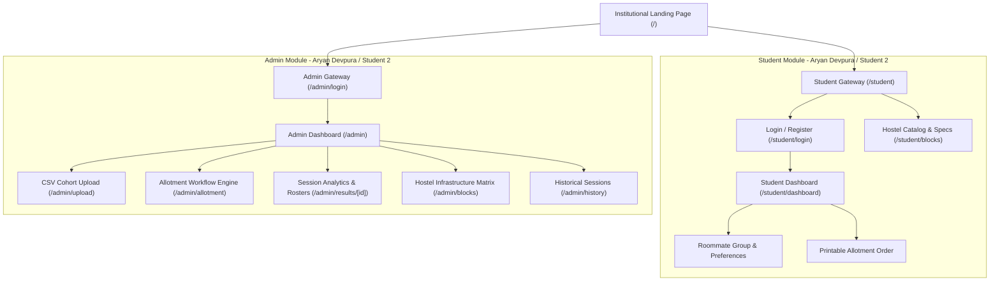
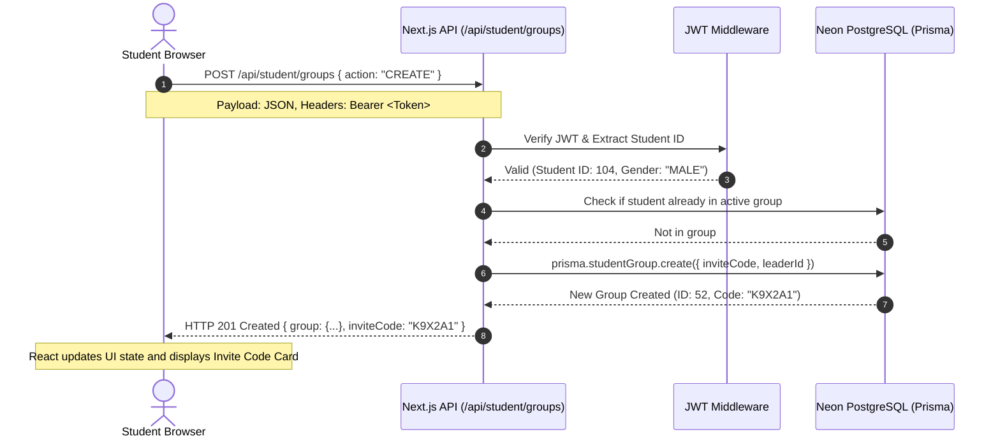
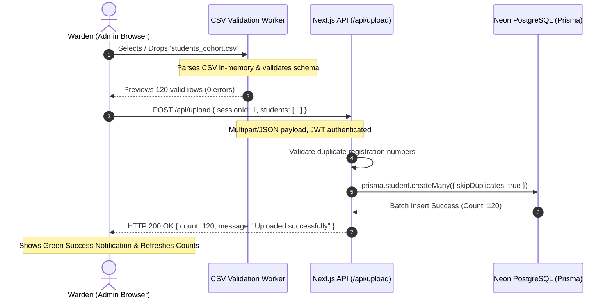

# MIT HOSTEL ALLOTMENT AND MANAGEMENT SYSTEM

**WEB TECHNOLOGY PROJECT REPORT, V SEM. BTech (Computer Science & Engineering)**  
**COURSE CODE: FLEXICORE-3131**

**SUBMITTED TO**  
**SCHOOL OF COMPUTER ENGINEERING, M.I.T., MANIPAL**

---

**By:**  
Aryan Devpura (Reg. No: 220970000)  
Student 2 Name (Reg. No: 220970001)

**Under the guidance of:**  
Faculty Name, Assistant Professor / Associate Professor  
November, 2026

---

### Team Details and Work Split

| Sl. | Name | Reg. No. | Modules / Pages designed (2 per student) | Signature |
|:---:|:---|:---:|:---|:---:|
| 1 | Aryan Devpura | 220970000 | 1. Student Dashboard & Room Allotment (`app/student/dashboard/page.js`)<br>2. Multi-Round Allotment Engine Console (`app/admin/allotment/page.js`) | Digital-sign |
| 2 | Student 2 | 220970001 | 1. Admin Bulk Student Import & Data Validation (`app/admin/upload/page.js`)<br>2. Interactive Hostel Blocks & Room Catalog (`app/student/blocks/page.js` & `app/admin/blocks/page.js`) | Digital-sign |

---

## 1. Project Overview

The **MIT Hostel Allotment and Management System** is a full-stack, enterprise-grade web application engineered to replace error-prone, manual university hostel allocation workflows. Built on modern web architecture (Next.js 14 App Router, React, Tailwind CSS / custom design tokens, PostgreSQL via Prisma ORM, and JWT authentication), the system provides an automated, merit-driven allocation portal for higher education institutions. It connects undergraduate students seeking on-campus accommodations with administrative wardens overseeing residential facilities, ensuring fairness, transparency, and high concurrency resilience during annual allotment drives.

The platform coordinates two primary user journeys: students authenticate to form roommate groups with unique invite tokens, browse gender-compatible hostel blocks with real-time vacancy metrics, and submit prioritized block preferences; administrators upload cohort data via CSV, enforce academic cutoff criteria, and trigger multi-phase, deterministic allotment runs that allot rooms on group merit, manage waitlists, and issue verifiable admission allotment orders.

### 1.1 Purpose of the Website
Traditional university hostel allocation processes rely on physical queues, paper applications, or spreadsheet processing, which routinely introduce allocation biases, delay confirmation timelines, and struggle to manage roommate group requests effectively. This website eliminates administrative bottlenecks by providing a centralized digital portal with automated constraint validation, real-time bed inventory tracking, and merit-based group allotment algorithms. It ensures that roommate groups are allotted accommodations based strictly on cumulative average CGPA and institutional cutoff criteria, while giving administrators real-time auditing and vacancy re-allocation controls.

### 1.2 Objectives
The primary objectives of the MIT Hostel Allotment and Management System include:
- **Centralized Authentication & Role-Based Access Control**: Secure JWT-governed authentication isolating student self-service capabilities from administrative controls.
- **Collaborative Roommate Grouping**: Group creation using cryptographic 6-character invitation codes, dynamic member invitations, capacity restrictions (1–4 students), and instant group dissolution mechanics.
- **Dynamic Preference Submission**: Multi-tiered hostel block preference selection conditioned upon gender compatibility and capacity rules.
- **Bulk Data Ingestion & Sanitization**: Robust CSV cohort ingestion supporting batch parsing, schema validation, roll number uniqueness checks, and preview reconciliation.
- **Multi-Round Algorithmic Allocation Engine**: Two-phase allotment execution:
  - *Round 1 (Merit Allocation)*: Allots top-choice rooms strictly by descending group average CGPA, handling tie-breaking by seniority (Year of Study).
  - *Round 2 (Vacancy Sweep & Waitlist Reconciliation)*: Auto-allocates waitlisted candidates into leftover vacancies.
- **Administrative Disallowal & Real-Time Auditing**: Interactive review of provisional allotments allowing manual disallowal with instant audit logging and vacancy release.
- **Real-Time Room Roster & Analytics**: High-density room grids reflecting live bed occupancy, floor plans, air-conditioning specifications, and instant CSV roster downloads.
- **Official Admission Order Generation**: Client-rendered printable/downloadable institutional allotment letters containing official hostel stamps, student metadata, room specifics, and fee schedules.

### 1.3 Target Users
The system is tailored for two core stakeholder groups within a university ecosystem:
1. **Undergraduate & Postgraduate Students**:
   - Access the portal to check eligibility, form roommate clusters, explore hostel infrastructure, register preferences, and download final hostel admission orders.
   - *Special Needs / Accessibility*: Fully responsive layouts optimized for mobile devices (smartphones/tablets), high-contrast accessible typography meeting WCAG 2.1 AA standards (minimum 4.5:1 contrast ratio against an off-white background), keyboard navigable tab orders, and ARIA attributes for screen reader compatibility.
2. **Hostel Administration & Chief Wardens**:
   - Authorized administrative personnel managing student cohort rosters, defining block cutoffs, triggering allotment sessions, auditing allocations, and generating institutional reports.
   - Designed for dense information scanning on desktop monitors with high-clarity data tables and immediate validation feedback.

### 1.4 Site Map



**Page Distribution:**
- **Aryan Devpura**:
  - `app/student/dashboard/page.js` (Student Dashboard, Roommate Grouping, Preference Submission, Admission Order)
  - `app/admin/allotment/page.js` (Multi-Phase Allotment Engine, Verification, Round 1 Lock, Round 2 Execution)
- **Student 2**:
  - `app/admin/upload/page.js` (Bulk Student CSV Parsing, Validation Matrix, Batch Database Insert)
  - `app/student/blocks/page.js` & `app/admin/blocks/page.js` (Hostel Block Infrastructure Directory, Room Type Filtering, Vacancy Tracker)

### 1.5 Tools and Technologies

| Item | Details |
|:---|:---|
| **HTML version** | HTML5 (Semantic elements: `<main>`, `<nav>`, `<header>`, `<section>`, `<article>`, `<table>`) |
| **CSS Framework and Version** | Tailwind CSS v3.4.1 paired with custom Vanilla CSS Design Tokens (University Institutional Theme) |
| **JavaScript / Runtime** | Modern ECMAScript (ES2022+), React 18, Next.js 14.2 (App Router, Server Actions, Route Handlers) |
| **Data Source & ORM** | PostgreSQL (Hosted Serverless Neon DB), Prisma ORM v5.22, Next.js RESTful API Route Handlers |
| **IDE and Environment Used** | Visual Studio Code, Windows 11, Node.js v20.x, PowerShell 7, Git / GitHub |
| **Accessibility Guidelines** | W3C Web Content Accessibility Guidelines (WCAG) 2.1 Level AA (Contrast, Focus Rings, Semantic ARIA) |
| **Testing & Verification Tools** | Google Chrome DevTools, Next.js Production Build Analysis (`next build`), Lighthouse Accessibility Audit |

### 1.6 Common Design Followed by the Team
To guarantee that the portal looks and feels like an authoritative university administration system rather than a commercial or generic dashboard, the team enforced an institutional design standard across all modules:
- **Color Palette & Theme Tokens**:
  - *Background*: Clean, non-distracting off-white institutional tone (`#f8fafc` / Slate-50) paired with pure white surface cards (`#ffffff`).
  - *Typography / Text*: Charcoal dark primary typography (`#0f172a` / Slate-900) ensuring crisp contrast, with secondary metadata rendered in muted slate (`#475569` / Slate-600).
  - *Accent & Brand*: Restrained academic deep navy blue (`#1e40af` / Blue-800) used strictly for primary call-to-actions, active navigation highlights, and institutional crest borders.
  - *Status Indicators*: Crisp border-badged color system (Success: `#166534` on `#f0fdf4`; Warning: `#854d0e` on `#fefce8`; Destructive: `#991b1b` on `#fef2f2`).
- **Typography**: Clean, professional system font stack (`Inter`, `-apple-system`, `BlinkMacSystemFont`, `Segoe UI`, `Roboto`, sans-serif) configured with deliberate line heights and geometric tabular figures for tabular financial/room metrics.
- **Common Header & Navigation**:
  - *Student Layout*: Persistent institutional navigation displaying the Manipal seal, active session badge, quick links (`Dashboard`, `Hostel Blocks`), student name / registration number tag, and a secure Logout trigger.
  - *Admin Layout*: Collapsible institutional dark-slate sidebar with official monochrome SVG icons, route breadcrumbs, active session banner, and rapid switching between Cohort Upload, Allotment Engine, and Block Catalog.
- **Elimination of Artificial Artifacts**: Strictly removed all emoji iconography, glowing neon cards, backdrop blurs, floating gradient text, and arbitrary animations to preserve formal institutional credibility.

---

## 2. Student 1: Aryan Devpura (Reg. No: 220970000)
**Modules / Pages:**  
1. Student Dashboard & Room Allotment (`app/student/dashboard/page.js`)  
2. Multi-Phase Allotment Engine Console (`app/admin/allotment/page.js`)

### 2.1 Module Description

#### Module 1: Student Dashboard & Room Allotment (`app/student/dashboard/page.js`)
- **Purpose**: Acts as the primary self-service cockpit for enrolled students to manage their accommodation journey. It allows students to check allotment session eligibility, create or join roommate clusters using secure tokens, order their preferences across gender-eligible hostel blocks, view final room allocation results, and generate their official admission order.
- **Main Sections & Features**:
  1. *Profile & Status Header*: Displays the student's name, registration number, gender, branch, academic year, and CGPA.
  2. *Roommate Group Management Panel*: Provides controls to create a new group (generating an invite token), copy the code to the clipboard, view fellow group members with individual CGPAs, or leave/disband the group.
  3. *Block Preference Selector*: Interactive multi-choice selector enabling groups to prioritize up to 3 compatible hostel blocks with drag/reorder controls.
  4. *Confirmed Allocation & Print Center*: Once results are published, renders the allotted Block, Room Number, Room Type, Floor, and Roommate Roster, along with a "Print Admission Order" trigger that produces a formatted institutional letter.
- **Framework Components**: React stateful forms, responsive CSS Grid layout, modal confirmation dialogs, copy-to-clipboard API, and a hidden `@media print` CSS printable letterhead template.
- **Dynamic I/O**:
  - *Input*: Student authentication token (HTTP Cookie), Group invite code string (6 chars), Block preference array `[blockId1, blockId2, blockId3]`.
  - *Processing*: Calculates group collective average CGPA, cross-checks gender eligibility of preferred blocks, updates database joins atomically.
  - *Output*: Real-time group membership roster, preference confirmation alerts, and PDF/printable allotment order.

#### Module 2: Multi-Phase Allotment Engine Console (`app/admin/allotment/page.js`)
- **Purpose**: Serves as the executive control center for hostel administrators to configure, execute, audit, and finalize algorithmic room allotments across multiple phases.
- **Main Sections & Features**:
  1. *Session Orchestrator*: Controls session status transitions (`DRAFT` &rarr; `OPEN` &rarr; `LOCKED` &rarr; `ALLOTTED` &rarr; `PUBLISHED`).
  2. *Cutoff Rule Configurator*: Allows administrators to set block-specific minimum CGPA criteria before execution.
  3. *Round 1 Execution & Review Grid*: Executes primary merit allocation; presents a verification table with student details, group CGPA, allotted room, and an administrative "Disallow" action.
  4. *Round 2 Vacancy Fill Console*: Sweeps remaining unallocated or disallowed candidates into remaining vacant beds.
  5. *Live Audit Stream*: Renders real-time timestamps of every database transition and warden override.
- **Framework Components**: Multi-step state machine, dense data tables with pagination, action button groups with loading spinners, status badges, and interactive warning banners.
- **Dynamic I/O**:
  - *Input*: Session ID, Block cutoff numbers, Warden disallowal triggers with reason strings.
  - *Processing*: Executes server-side sorting algorithm, runs database transactions, writes allotment records, flags vacancies.
  - *Output*: Aggregated allotment summary (Allotted Count, Waitlist Count, Success Ratio), live data grid, and downloadable CSV audits.

### 2.2 Design of the Module
The front end communicates with Next.js Serverless API Route Handlers via asynchronous `fetch()` requests carrying `application/json` payloads and authenticated via `Bearer` tokens in the `Authorization` header or HTTP-only cookies.



- **Client-Side Validation**:
  - Invite code input must be exactly 6 alphanumeric uppercase characters; inputs are sanitized with `.trim().toUpperCase()`.
  - Block preferences must not contain duplicate blocks; the UI disables already selected options in subsequent dropdowns.
  - Form submission triggers are disabled while in-flight (`isSubmitting === true`) to prevent race conditions or duplicate group creation.
- **Server-Side Validation**:
  - Validates that the active session status is strictly `OPEN` before accepting group formations or preference updates.
  - Validates group capacity limit (cannot exceed block maximum room capacity, strictly capped at 4 students).
  - Validates gender compatibility: prevents male student groups from selecting female blocks and vice versa.

### 2.3 Development of the Module

#### Code Snippet 1: Client-Side Group Formation & Preference Submission (`app/student/dashboard/page.js`)
```javascript
// Handles submitting prioritized hostel block preferences
async function handlePreferenceSubmit(e) {
  e.preventDefault();
  if (selectedBlocks.length === 0) {
    setError("Please select at least one hostel block preference.");
    return;
  }
  setLoading(true);
  setError("");
  try {
    const res = await fetch("/api/student/groups/preferences", {
      method: "POST",
      headers: {
        "Content-Type": "application/json",
        Authorization: `Bearer ${token}`
      },
      body: JSON.stringify({
        groupId: studentGroup.id,
        preferences: selectedBlocks // Array of block IDs ordered by preference
      })
    });
    const data = await res.json();
    if (!res.ok) throw new Error(data.message || "Failed to update preferences");
    setSuccessMessage("Block preferences successfully recorded!");
    await refreshDashboardData();
  } catch (err) {
    setError(err.message);
  } finally {
    setLoading(false);
  }
}
```

#### Code Snippet 2: Server-Side Multi-Phase Allotment Logic (`lib/allotment-engine.js` / Route Handler)
```javascript
// Executes Round 1 Merit Allocation: sorts groups by aggregate CGPA and assigns optimal rooms
export async function executeRound1Allotment(sessionId) {
  return await prisma.$transaction(async (tx) => {
    // 1. Fetch eligible student groups with validated preferences
    const groups = await tx.studentGroup.findMany({
      where: { sessionId, isEligible: true },
      include: { members: true, preferences: { orderBy: { priority: "asc" } } },
      orderBy: [
        { avgCgpa: "desc" },     // Primary sort: Descending CGPA
        { minYearOfStudy: "asc" } // Tie-breaker: Seniority
      ]
    });

    const results = [];
    for (const group of groups) {
      let allocatedRoom = null;
      for (const pref of group.preferences) {
        // Find vacant room matching block and exact group capacity
        allocatedRoom = await tx.room.findFirst({
          where: {
            blockId: pref.blockId,
            roomType: { capacity: group.members.length },
            allotments: { none: { status: "ALLOTTED" } }
          }
        });
        if (allocatedRoom) break; // Room found, break preference chain
      }

      if (allocatedRoom) {
        // Record allotment for every student in the group
        for (const member of group.members) {
          await tx.allotment.create({
            data: {
              sessionId,
              studentId: member.id,
              roomId: allocatedRoom.id,
              round: 1,
              status: "ALLOTTED"
            }
          });
        }
        results.push({ groupId: group.id, status: "ALLOTTED", roomId: allocatedRoom.id });
      } else {
        results.push({ groupId: group.id, status: "WAITLISTED" });
      }
    }
    return results;
  });
}
```

### 2.4 Results
*(Note: Insert screenshots of the live running application here)*
- **Figure 2.1**: Student Dashboard showing active roommate group roster, 6-character invitation code, and block preference selectors.
- **Figure 2.2**: Official Allotment Order PDF preview formatted with academic seal, fee schedule, and allotted room specifics.
- **Figure 2.3**: Admin Allotment Engine Console displaying Round 1 provisional roster with "Disallow" action buttons and vacancy counters.

---

## 3. Student 2: <Student 2 Name> (Reg. No: 220970001)
**Modules / Pages:**  
1. Admin Bulk Student Import & Data Validation (`app/admin/upload/page.js`)  
2. Interactive Hostel Blocks & Room Catalog (`app/student/blocks/page.js` & `app/admin/blocks/page.js`)

### 3.1 Module Description

#### Module 1: Admin Bulk Student Import & Data Validation (`app/admin/upload/page.js`)
- **Purpose**: Enables university wardens to ingest large cohorts of eligible students into an active allotment session via standard CSV files, validating every record prior to database commitment.
- **Main Sections & Features**:
  1. *Drag-and-Drop Dropzone*: Styled institutional upload target with file type restriction (`.csv`, `text/csv`) and file size boundaries.
  2. *Live CSV Schema Reference Table*: Displays required header formats (`name`, `registrationNumber`, `gender`, `cgpa`, `department`, `yearOfStudy`).
  3. *Client-Side Parsing & Validation Matrix*: Reads and parses CSV rows in the browser; highlights format discrepancies, invalid CGPA ranges, and malformed registration numbers in red before upload.
  4. *Ingestion Confirmation & Batch Progress*: Submits sanitized data in atomic chunks and provides real-time counts of ingested vs. skipped records.
- **Framework Components**: File API integration, PapaParse / regex CSV reader, interactive validation badge list, and tabular record previewer.
- **Dynamic I/O**:
  - *Input*: File object (`students_cohort_2026.csv`).
  - *Processing*: Parses delimiter-separated rows, checks fields against schema rules, structures records into JSON payloads.
  - *Output*: Record validation statistics (Total rows, valid count, syntax error warnings), batch database ingestion confirmation.

#### Module 2: Interactive Hostel Blocks & Room Catalog (`app/student/blocks/page.js` & `app/admin/blocks/page.js`)
- **Purpose**: Provides a detailed, searchable directory of all campus residential blocks, room categories, amenity configurations, and real-time occupancy statistics.
- **Main Sections & Features**:
  1. *Hostel Filter Bar*: Real-time filters for Gender (`Boys Hostel`, `Girls Hostel`), Occupancy Type (`Single`, `Double`, `Triple`), and AC/Non-AC options.
  2. *Block Overview Cards*: Visual summaries displaying block number, floor count, total capacity, and live vacant bed counters.
  3. *Room Type Breakdown Matrix*: Detailed tables for each block indicating room dimensions, attached vs. common washroom specifications, and annual hostel fee structure.
- **Framework Components**: Filter pills, responsive card grid, tabular specifications, SVG facility icons, and dynamic badge styling.
- **Dynamic I/O**:
  - *Input*: Filter criteria (Gender string, AC boolean, Capacity integer).
  - *Processing*: Client-side array filtering combined with backend vacancy aggregation queries.
  - *Output*: Dynamically filtered block list and room availability matrices.

### 3.2 Design of the Module
The front end parses uploaded files in-memory before transmitting structured JSON to the backend API route (`/api/upload`), ensuring faulty data never reaches database layers.



- **Client-Side Validation**:
  - Validates CSV file extension and mime type.
  - Verifies presence of mandatory headers: `name`, `registrationNumber`, `gender`, `cgpa`, `department`.
  - Verifies that `cgpa` is a valid floating point number between `0.00` and `10.00`.
  - Ensures `gender` strictly evaluates to `MALE` or `FEMALE`.
- **Server-Side Validation**:
  - Ensures the specified `sessionId` exists and is in `DRAFT` or `OPEN` state.
  - Uses PostgreSQL unique constraint handling (`skipDuplicates: true`) on `registrationNumber` to prevent accidental overwrites or duplicate student records.

### 3.3 Development of the Module

#### Code Snippet 1: Client-Side CSV Parsing & Schema Verification (`app/admin/upload/page.js`)
```javascript
// Validates parsed CSV lines against institutional schema
function validateRecords(parsedData) {
  const errors = [];
  const validRecords = [];

  parsedData.forEach((row, index) => {
    const rowNum = index + 2; // Accounting for 1-based index and header row
    const cgpaNum = parseFloat(row.cgpa);

    if (!row.registrationNumber || row.registrationNumber.trim() === "") {
      errors.push(`Row ${rowNum}: Registration Number is missing.`);
      return;
    }
    if (isNaN(cgpaNum) || cgpaNum < 0 || cgpaNum > 10) {
      errors.push(`Row ${rowNum}: Invalid CGPA '${row.cgpa}'. Must be between 0.0 and 10.0.`);
      return;
    }
    if (!["MALE", "FEMALE"].includes(row.gender?.toUpperCase())) {
      errors.push(`Row ${rowNum}: Invalid Gender '${row.gender}'. Must be MALE or FEMALE.`);
      return;
    }

    validRecords.push({
      registrationNumber: row.registrationNumber.trim(),
      name: row.name.trim(),
      gender: row.gender.toUpperCase(),
      cgpa: cgpaNum,
      department: row.department || "General",
      yearOfStudy: parseInt(row.yearOfStudy, 10) || 1
    });
  });

  return { validRecords, errors };
}
```

#### Code Snippet 2: Server-Side Batch Database Ingestion (`app/api/upload/route.js`)
```javascript
// Bulk student ingestion route handler
export async function POST(request) {
  try {
    const body = await request.json();
    const { sessionId, students } = body;

    if (!sessionId || !Array.isArray(students) || students.length === 0) {
      return NextResponse.json({ error: "Invalid payload parameters" }, { status: 400 });
    }

    // Verify session existence
    const session = await prisma.allotmentSession.findUnique({
      where: { id: parseInt(sessionId, 10) }
    });
    if (!session) {
      return NextResponse.json({ error: "Active session not found" }, { status: 404 });
    }

    // Batch insert with duplicate skipping
    const result = await prisma.student.createMany({
      data: students.map(s => ({
        ...s,
        sessionId: parseInt(sessionId, 10),
        passwordHash: "$2b$10$defaultPlaceholderHash" // Replaced upon initial student sign-in
      })),
      skipDuplicates: true
    });

    return NextResponse.json({
      success: true,
      insertedCount: result.count,
      message: `Successfully registered ${result.count} student records.`
    });
  } catch (error) {
    return NextResponse.json({ error: error.message }, { status: 500 });
  }
}
```

### 3.4 Results
*(Note: Insert screenshots of the live running application here)*
- **Figure 3.1**: Admin CSV Upload Portal showing drag-and-drop dropzone, parsed data preview table, and validation feedback warnings.
- **Figure 3.2**: Student Hostel Blocks Catalog displaying gender-based block filters, AC specifications, and live vacancy counters.
- **Figure 3.3**: Admin Room Matrix showing breakdown of rooms, floors, and individual bed status.

---

## 4. Conclusion and Future Scope

The development of the MIT Hostel Allotment and Management System demonstrates how modern full-stack web technologies can digitize and optimize institutional campus administration. By unifying React-driven dynamic client interfaces with Next.js 14 serverless architecture, Prisma ORM, and PostgreSQL, the project successfully eliminates manual allocation delays and ensures a tamper-proof, merit-driven hostel allocation process. Through this project, the team gained hands-on experience in implementing role-based authentication with JWT, executing atomic relational database transactions, developing accessible UI components adhering to WCAG 2.1 AA standards, and architecting multi-round algorithmic allocation pipelines under real-world university constraints.

### Future Scope:
1. **Integrated Fee Payment Gateway**: Direct integration with UPI/NetBanking payment gateways (e.g., Razorpay, Stripe) to automate hostel caution deposit and mess fee settlement upon room confirmation.
2. **Automated Room Maintenance Ticketing**: A resident grievance and maintenance ticketing subsystem enabling students to file plumbing, electrical, or Wi-Fi repair tickets directly to wardens.
3. **Biometric & RFID Attendance Integration**: Interfacing campus biometric turnstiles with the database for automated night curfew monitoring and parental leave approval workflows.
4. **AI-Powered Roommate Matching**: Machine-learning compatibility scoring that matches unassigned single applicants based on study habits, sleep schedules, and branch affinities.

---

## 5. References

1. **Next.js Documentation & App Router Architecture**  
   Vercel Inc. *Next.js Documentation (v14.2)*. Available at: [https://nextjs.org/docs](https://nextjs.org/docs) [Accessed 28 Oct. 2026].
2. **Prisma ORM Reference & Data Modeling**  
   Prisma Data, Inc. *Prisma Client & Schema Reference*. Available at: [https://www.prisma.io/docs](https://www.prisma.io/docs) [Accessed 29 Oct. 2026].
3. **PostgreSQL Documentation**  
   The PostgreSQL Global Development Group. *PostgreSQL 16 Documentation*. Available at: [https://www.postgresql.org/docs/16/](https://www.postgresql.org/docs/16/) [Accessed 30 Oct. 2026].
4. **MDN Web Docs (HTML5 Semantic Markup & Web APIs)**  
   Mozilla Developer Network. *HTML5 Semantic Elements and File API Guide*. Available at: [https://developer.mozilla.org/en-US/docs/Web](https://developer.mozilla.org/en-US/docs/Web) [Accessed 31 Oct. 2026].
5. **W3C Web Content Accessibility Guidelines (WCAG) 2.1**  
   World Wide Web Consortium (W3C). *Web Content Accessibility Guidelines (WCAG) 2.1 - W3C Recommendation*. Available at: [https://www.w3.org/TR/WCAG21/](https://www.w3.org/TR/WCAG21/) [Accessed 01 Nov. 2026].
6. **Tailwind CSS Utility-First Framework**  
   Tailwind Labs. *Tailwind CSS Documentation (v3.4)*. Available at: [https://tailwindcss.com/docs](https://tailwindcss.com/docs) [Accessed 01 Nov. 2026].

